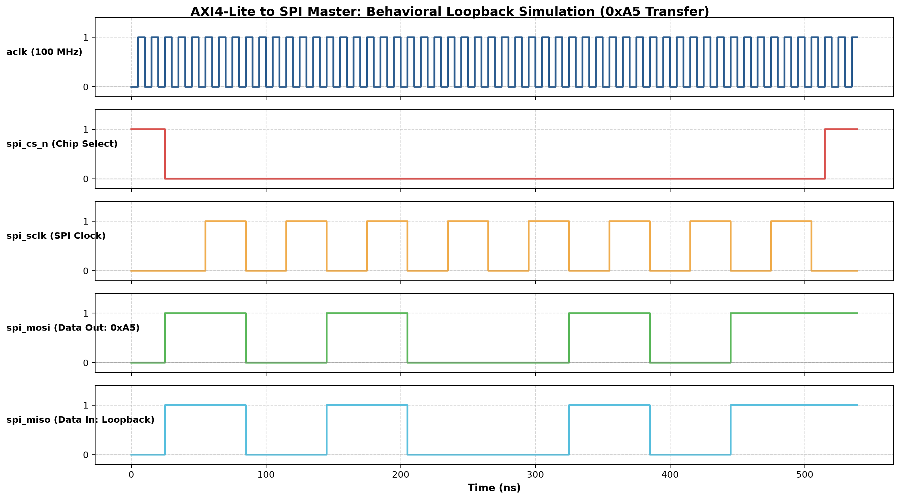

# AXI4-Lite SPI Master IP & EDA Automation

A synthesizable 8-bit SPI Master peripheral interfaced to an **AXI4-Lite** slave bus, packaged for the Xilinx Vivado IP Catalog, and automated via headless Tcl / Icarus Verilog simulation.

[](https://github.com/BharathGDevadiga/axi-spi-ip/actions)

---

## Architecture & Register Map

The peripheral exposes four 32-bit memory-mapped registers via an AXI4-Lite slave interface:

| Offset | Register Name | Access | Description |
| :---: | :---: | :---: | :--- |
| `0x0` | `TX_DATA` | Write | Bits [7:0]: Byte to transmit on MOSI |
| `0x4` | `RX_DATA` | **Read-Only** | Bits [7:0]: Byte received from MISO. Software writes are ignored in hardware. |
| `0x8` | `CTRL_STATUS` | Read/Write | Bit [0]: `START` (Rising-edge triggered transfer)<br>Bit [1]: `BUSY` (**Read-Only**, 1 = transfer active) |
| `0xC` | `CLK_DIV` | Write | Prescaler divider for SPI `SCLK` generation |

---

## Verification & Proof of Operation

The core is verified using a self-checking testbench (`src/tb/tb_axi_spi.v`) covering two test scenarios:
1. **SPI Loopback Transfer:** Transmits byte `0xA5` with clock divider 2, polls `BUSY` until 0, and asserts that the received byte equals `0xA5` without bit errors.
2. **Read-Only Register Protection:** Attempts a CPU write of `0xFF` to read-only register `0x4` (`RX_DATA`) and asserts that the stored hardware value remains intact.

### Simulation Waveform
Below is the cycle-accurate behavioral simulation waveform captured from `waveform.vcd` showing `cs_n` assert, `sclk` generation, and synchronous 8-bit serial shift on `mosi` / `miso`:



### Automated Testbench Console Output

```text
=== STARTING AXI SPI MASTER VERIFICATION ===
[TEST 1] Transmitting 0xA5 over SPI loopback...
[INFO] Loopback verified: received 0xA5 correctly.
[TEST 2] Verifying RX_DATA register cannot be overwritten by CPU...
[INFO] Read-only gating verified: write was properly ignored.

[PASS] All AXI-SPI Master Tests Passed Successfully!
```

---

## How to Run Verification

### Method 1: Headless Icarus Verilog Simulation
```bash
iverilog -o sim_axi_spi src/rtl/*.v src/tb/tb_axi_spi.v
vvp sim_axi_spi
```

### Method 2: Headless Vivado Batch Mode
```bash
vivado -mode batch -source scripts/build.tcl
```
